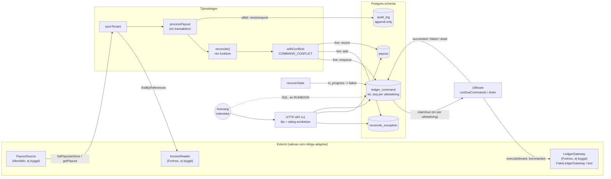
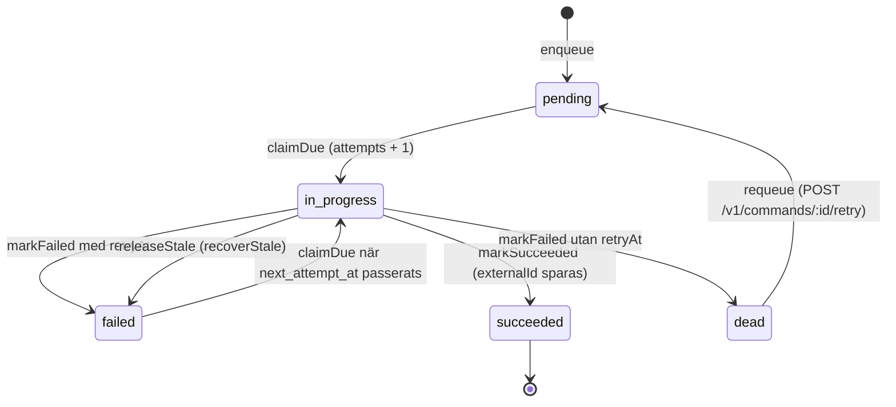
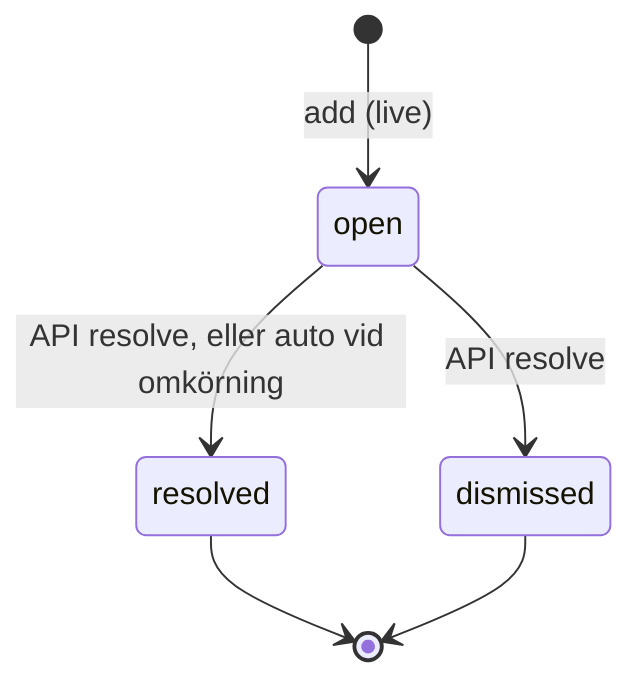

# Arkitektur: så som den är implementerad

Det här dokumentet beskriver koden i repot, inte önskemål (läget när det skrevs, migrationerna 001 till 003). Där `docs/SPEC.md` och koden skiljer sig gäller koden, och skillnaden är utpekad i avsnitt 10. Se även [DECISIONS.md](DECISIONS.md), [RUNBOOK.md](RUNBOOK.md), [SECURITY.md](SECURITY.md) och [API.md](API.md).

## 1. Ärlig statusbild

| Del | Status |
| --- | --- |
| Avstämningsmotor (`src/engine/reconcile.ts`) | Implementerad och testad, ren funktion |
| Tjänstelager (`processPayout`, `syncTenant`) | Implementerat och testat |
| Databas (`src/db`) | Schema, kommandokö, repositorier. `createPgDb` (`src/db/pg.ts`, `pg`-pool) för riktig Postgres och `createPgliteDb` för test. Postgres-klienten testas av `test/pg` mot en riktig Postgres (`npm run test:pg`, och CI-jobbet via `PG_TEST_URL`) |
| Utförare (`src/executor`) | Implementerad som funktioner |
| Körcykel (`src/app/cycle.ts`) | `runCycle`: `recoverStale`, `syncTenant` per kund, `drain`, och returnerar larmlista (`alerts`). `src/main.ts` anropar den med kedjade timeouts (`CYCLE_INTERVAL_MS`), så att två cykler aldrig överlappar i samma process |
| HTTP-API (`src/api/server.ts`) | Implementerat (läsning + stänga avvikelser). `src/main.ts` startar servern, kör migrationer och hanterar SIGTERM/SIGINT graciöst (`npm start`) |
| Kunder och API-nycklar (`src/db/tenants.ts`, `src/security/apiKeys.ts`) | Implementerat: tabellerna `tenant` och `api_key`, nycklar lagras som HMAC med pepper, återkallning och utgångsdatum. Ingen endpoint eller kommandorad för att skapa kunder eller nycklar |
| Anslutningar och tokenkryptering (`src/db/connections.ts`, `src/security/crypto.ts`) | Implementerat: AES-256-GCM, nyckel-id i blobben, omkryptering. Endast `StaticKeyProvider` (test/dev) finns. Ingen KMS-provider. **Ingen adapter använder det ännu** |
| Gateway mot affärssystem | **Endast `FakeLedgerGateway`** (`src/gateways/fake.ts`). Ingen Fortnox-adapter. Ingen verifierad kunskap om Fortnox API finns i repot |
| Källa för utbetalningar (`PayoutSource`) | **Endast ett gränssnitt** (`src/ports/sources.ts`). Ingen Mondido-adapter |
| Fakturaläsning (`InvoiceReader`) | **Endast ett gränssnitt** |
| Schemaläggning (cron, loop), KMS-nyckelleverantör, daglig kontrollsumma | **Finns inte**. `runCycle` returnerar larm men skickar dem ingenstans |

Allt som körs idag är alltså kärnlogik, databasschema och simulerade ytterkanter. Inga pengar eller verifikat kan flyttas i något riktigt system.

## 2. Lager

```
src/domain      Typer och beloppshantering (heltal i minsta enhet). Ingen I/O.
src/engine      reconcile(): ren funktion. Indata -> kommandon + avvikelser.
src/ports       Gränssnitt: CommandRepository, ExceptionRepository, PayoutRepository,
                AuditLog, UnitOfWork, LedgerGateway, Clock (index.ts)
                PayoutSource, InvoiceReader, TenantConfigProvider, SyncStateStore (sources.ts)
src/service     processPayout (en utbetalning), syncTenant (en kund, flera utbetalningar)
src/executor    runDueCommands, drain, recoverStale, backoffDelayMs
src/db          Db-gränssnitt (pg.ts, PGlite), migrationer, repositorier (SQL), tenants, connections, syncState
src/security    apiKeys.ts (nyckelhash, authenticator), crypto.ts (envelope encryption)
src/app         cycle.ts: en körcykel (recover, synk, utför)
src/gateways    FakeLedgerGateway, FakePayoutSource (test)
src/api         Fastify-server (buildServer)
src/testing     In-memory-implementationer av portarna (test)
```

Beroenderiktning: `api`, `service`, `executor` och `db` beror på `ports` och `domain`. `engine` beror bara på `domain`. Kärnan känner inte till Postgres, Fastify eller någon leverantör.

`Db` (`src/db/db.ts`) är ett eget minimalt gränssnitt (`query`, `exec`, `transaction`). Det har två implementationer: `createPgliteDb` (tester) och `createPgDb` (`src/db/pg.ts`, `pg.Pool`, int8 tolkas som säkert heltal eller kastar).

## 3. Dataflöde



Steg för steg:

1. **Hämta.** `syncTenant` läser kundens konfiguration (`TenantConfigProvider`: kontoplan och `mode`), hämtar utbetalningar efter sparad cursor via `PayoutSource.listPayoutsSince` och hämtar kandidatfakturor per utbetalning via `InvoiceReader.findByReferences`. Därefter försöker den på nytt för utbetalningar som står som `partial` (bara i live-läge) via `PayoutSource.getPayout`.
2. **Avstäm.** `processPayout` öppnar en transaktion (`UnitOfWork.run`), läser redan köade kommandon för utbetalningen och härleder `settledLineIds` (rader som redan har betalnings- eller krediteringskommando). Därefter anropas `reconcile()`.
3. **Motorn** (`reconcile`) validerar utbetalningen (summa, valuta, dubbletter, ogiltiga belopp) och avvisar hela utbetalningen (`rejected`) vid fel. Sedan matchas betalningar före återbetalningar, båda i id-ordning, mot fakturor på exakt referens och exakt belopp. Verifikat byggs först när inga avvikelser finns kvar.
4. **Konfliktkontroll.** `withConflicts` jämför redan köade kommandon med vad utbetalningen säger nu. Skillnad ger `COMMAND_CONFLICT`.
5. **Spara (live).** Kommandon läggs i kön, avvikelser läggs in, öppna avvikelser som inte längre uppstår stängs automatiskt, utbetalningsstatus skrivs och en revisionspost läggs till. Allt i samma transaktion.
6. **Utför.** Utföraren hämtar förfallna kommandon (`claimDue`), anropar `LedgerGateway.execute` och sparar resultatet (`markSucceeded` eller `markFailed`).
7. **Följ upp.** Människa läser avvikelser och utbetalningar via API:t, och hanterar döda kommandon via SQL (se RUNBOOK).

`runCycle` (`src/app/cycle.ts`) knyter ihop stegen: släpp fastnade kommandon (`recoverStale`), `syncTenant` för varje kund i `listTenants()`, därefter `drain`. Ett fel för en kund stoppar inte de andra. Den returnerar en `CycleReport` med `alerts`: `warning` för avvisade/misslyckade utbetalningar och misslyckad synk, `critical` när kommandon blivit `dead`, `warning` för `unconfirmed`. `src/main.ts` kör `runCycle` på schema och loggar larmen som varningar, men **inget skickar dem vidare** (e-post, pager). Kön tål flera samtidiga arbetare, så flera processer kan köras. Kunder som synkas ska vara aktiva och ha kontoplan (`listSyncableTenants`). Köns `claimDue` utför dessutom aldrig kommandon för en kund som är avstängd eller satts tillbaka i dry_run, så en avstängning stoppar även redan köad bokföring. En kund utan kontoplan, eller avstängd, får ingen konfiguration (`createTenantConfigProvider` returnerar null) och synkas därför inte.

## 4. Tillståndsmaskiner

### 4.1 Kommandostatus (`ledger_command.status`, `CommandStatus`)



Regler (från `executor.ts` och `repositories.ts`):

- Standardvärden: `batchSize` 25, `maxAttempts` 8, `baseDelayMs` 30 000, `maxDelayMs` 3 600 000. Backoff är `base * 2^(försök-1)` begränsat till max, utan slump.
- `LedgerError` med `retryable = false` ger `dead` direkt. Andra fel än `LedgerError` räknas som tillfälliga. När `attempts >= maxAttempts` blir kommandot `dead` även om felet var tillfälligt.
- `LedgerError.retryAfterMs` används som väntetid i stället för backoff när det anges.
- `last_error` sparas (högst 500 tecken) i databasen men exponeras aldrig av API:t (bara `hasError`).
- `releaseStale` sätter kommandot till `failed` med `next_attempt_at = nu`. `attempts` nollställs inte.
- `dead` är terminal i koden. Det finns ingen funktion eller endpoint som återupptar ett dött kommando.

### 4.2 Utbetalningsstatus (`payout.status`, `PayoutStatus`)

| Status | Betydelse |
| --- | --- |
| `rejected` | Utbetalningen gick inte att lita på (se avsnitt 7). Inget köades |
| `partial` | Minst en avvikelse är öppen, ELLER minst ett av utbetalningens kommandon är `dead` |
| `complete` | Alla rader lösta, verifikat köat, inget kommando `dead` |

Viktigt att förstå: `complete` betyder att utbetalningen är fullt avstämd och **köad**, inte att kommandona är utförda. Statusen skrivs bara när `processPayout` körs i live-läge (`payout`-raden skrivs över vid varje körning). Blir ett kommando `dead` efter att utbetalningen markerats `complete` sätter utföraren (`onDead` i `createApp`) utbetalningen till `partial` direkt och skriver en revisionspost (`command.dead`). Dessutom larmar `runCycle` kritiskt i varje cykel så länge något kommando är dött (`countDead`). För att se verklig utförandestatus, läs kommandona (`GET /v1/payouts/:id`). Både `partial` och `rejected` återupptas av `syncTenant` i live-läge (en saknad faktura kan ha dykt upp, eller leverantören kan ha rättat utbetalningen).

### 4.3 Avvikelsestatus (`reconcile_exception.status`, `ExceptionStatus`)



- Unikhet gäller bara bland öppna: `(tenant_id, payout_id, code, coalesce(line_id,''))` där `status = 'open'`. Samma avvikelse läggs alltså inte in två gånger medan den är öppen.
- Att stänga en avvikelse (`resolved` eller `dismissed`) via API:t ändrar **bara avvikelsen**. Inget kommando skapas eller ändras. Om orsaken kvarstår uppstår avvikelsen på nytt (som ny öppen rad) vid nästa live-körning av utbetalningen.
- Vid omkörning stänger `processPayout` öppna avvikelser som inte längre uppstår, med anteckningen "Löstes automatiskt vid omkörning".
- `ExceptionCode` är detaljerad i [RUNBOOK.md](RUNBOOK.md).

## 5. Ordningsgarantier

- **Per utbetalning:** kommandon får ett löpnummer `seq` (unikt per `(tenant_id, payout_id)`) när de köas. `claimDue` släpper bara fram ett kommando om alla tidigare `seq` i samma utbetalning är `succeeded`. Konsekvenser:
  - Verifikatet, som köas sist, utförs aldrig före sina betalningar och krediteringar.
  - Ett kommando som är `failed`, `in_progress` eller `dead` blockerar alla efterföljande i samma utbetalning. Ett `dead` kommando blockerar tills en människa agerat.
  - En omgång av utföraren tar därför högst ett kommando per utbetalning. `drain` kör omgångar tills kön är tom (högst 100 omgångar som standard).
- **Vid omkörning** hamnar nya kommandon efter redan köade (`max(seq)+1`). Köandet serialiseras per utbetalning med `pg_advisory_xact_lock`, så två samtidiga omkörningar får inte samma `seq`.
- **Inom en körning** av motorn behandlas rader sorterade på rad-id, betalningar före återbetalningar. Utfallet beror alltså inte på vilken ordning leverantören listar raderna.
- **Mellan utbetalningar och mellan kunder:** ingen ordningsgaranti. Kommandon i olika utbetalningar kan utföras i valfri ordning och parallellt.
- **Återbetalning som kommer före betalning har utförts:** om betalningsraden redan är köad men fakturan ännu är öppen hos affärssystemet ger en omkörning `INVOICE_NOT_OPEN` för återbetalningen. Den löses automatiskt vid en senare omkörning när betalningen utförts och färsk fakturastatus hämtats.

## 6. Idempotens: vad som garanteras och var det kan brytas

| Nivå | Mekanism | Garanti | Kan brytas om |
| --- | --- | --- | --- |
| Motor | Deterministisk. Nyckel = `tenant:utbetalning:rad:typ` (delar URL-kodade), `tenant:utbetalning:voucher` för verifikatet | Samma indata ger samma kommandon och nycklar | Leverantören ändrar en rads innehåll (se konfliktkontroll nedan) |
| Kö | `ledger_command.key` är `unique`, `enqueue` använder `on conflict (key) do nothing` | Samma kommando köas aldrig två gånger | Nyckeln ändras. Nyckeln innehåller tenant, utbetalning och rad-id, så ett ändrat rad-id ger ett nytt kommando |
| Omkörning | `settledLineIds` härleds ur redan köade kommandon, så köade rader matchas inte igen | Omkörning skapar inga falska avvikelser mot redan betalda fakturor | Raden saknas eller är ändrad (hanteras som `COMMAND_CONFLICT`) |
| Konflikt | `withConflicts` jämför köat kommando mot nuvarande rad/kommando (belopp och typ för rader, stabil serialisering för verifikat) | Tyst "första vinner" blir en synlig avvikelse. Det köade kommandot behålls oförändrat | Fält som inte jämförs för rader: bara typ och belopp kontrolleras direkt mot raden (fakturareferens, avgifter etc. fångas bara via verifikatets jämförelse) |
| Utförande | `LedgerGateway.execute` **måste** vara idempotent på `command.key` (krav i `ports/index.ts`) | Samma kommando kan köras två gånger utan dubbelbokning | **Gatewayen bryter kravet.** Se nedan |

### Gatewayens krav är den svagaste länken

Utföraren ger *minst en gång*-leverans, inte *exakt en gång*. Samma kommando körs två gånger bland annat när:

1. Affärssystemet tog emot kommandot men processen kraschade, eller `markSucceeded` misslyckades, innan resultatet sparades. Kommandot ligger kvar som `in_progress` (räknas som `unconfirmed` i `RunSummary`) och släpps av `recoverStale`.
2. `recoverStale` släpper ett kommando som egentligen fortfarande kör (gränsen är 30 minuter som standard, `DEFAULT_STALE_AFTER_MS`, vald större än en hel omgång: `batchSize` x `executeTimeoutMs`. Varje anrop mot affärssystemet har dessutom en timeout, 60 s som standard). Då kan två utförare köra samma kommando samtidigt.
3. Ett tillfälligt fel (till exempel timeout) inträffar efter att affärssystemet utfört kommandot.

I alla tre fallen är det **enbart gatewayens idempotens** som förhindrar dubbelbokning. `FakeLedgerGateway` uppfyller kravet (slår upp nyckeln i minnet först). **Det är inte verifierat att Fortnox kan stödja det.** SPEC avsnitt 6 antar att Fortnox saknar inbyggd idempotens. En riktig adapter måste därför själv kunna avgöra "är det här redan gjort?" innan den skriver, till exempel genom att spara nyckeln i ett fält på fakturan/verifikatet eller i en egen tabell, och kontrollera den. Särskilt svårt är fallet där anropet nått Fortnox men svaret försvann: adaptern måste då kunna slå upp resultatet i Fortnox. Tills detta är löst och testat mot Fortnox sandbox ska systemet inte köras live.

Kö-nivåns unikhet gäller globalt på `key`. Nyckeln innehåller tenant-id, så kunder kolliderar inte. In-memory-implementationen (`src/testing/memory.ts`) skopar nyckeln på `(tenant, key)`, vilket är ekvivalent så länge nycklarna byggs av motorn.

### Konfliktdetektion (`COMMAND_CONFLICT`)

`withConflicts` i `processPayout.ts` flaggar, för varje redan köat betalnings-/krediteringskommando, om raden saknas, har fel typ, eller har ett annat belopp. För varje nytt kommando vars nyckel redan finns köad flaggas det om innehållet skiljer sig (typiskt verifikatet när avgifter ändrats). Resultatet blir en avvikelse och status `partial` i stället för `complete`. Det köade kommandot ändras aldrig automatiskt.

## 7. Vad motorn avvisar och vad den lämnar åt människor

- **Avvisar hela utbetalningen (`rejected`, inget köas):** `INVALID_PAYOUT`, `EMPTY_PAYOUT`, `DUPLICATE_LINE_ID`, `CURRENCY_MISMATCH` (rad mot utbetalning), `INVALID_AMOUNT` (ogiltigt eller för stort belopp), `PAYOUT_SUM_MISMATCH`, `DUPLICATE_INVOICE_ID`.
- **Delvis (`partial`):** säkra rader får kommandon. Övriga rader ger avvikelser per rad. **Verifikat skapas inte** förrän alla rader är lösta.
- **Matchning:** endast exakt referens (efter `trim`) och exakt belopp (`payment.amount === invoice.balance`). Ingen matchning på belopp/kund/datum (SPEC 5.1 punkt 2 är inte implementerad). Delbetalningar av en faktura stöds inte (`AMOUNT_MISMATCH`).
- **Belopp:** heltal i minsta enhet. `allocate` (största återstoden) delar kreditering på moms och netto proportionellt mot det som återstår att kreditera.
- **Flera valutor:** stöds inte. Alla rader måste ha utbetalningens valuta.
- **Kontoplan:** `AccountMapping` (bank, clearing, avgiftskostnad, avgiftsmoms) skickas in per körning. Verifikat: debet bank (utbetalt netto), debet avgiftskostnad och avgiftsmoms, kredit clearing (betalningar minus återbetalningar).

## 8. `dry_run`

`dry_run` är ett läge i `processPayout` (`mode: 'dry_run'`) och en inställning per kund i `TenantConfig.mode`. Det betyder:

- Motorn och konfliktkontrollen körs fullt ut, mot färsk fakturastatus och mot redan köade kommandon. Resultatet (`ProcessPayoutOutcome.result`) returneras som förslag.
- **Ingenting skrivs.** Inga kommandon köas, inga avvikelser läggs in, ingen `payout`-rad skrivs, inga avvikelser stängs, och ingen revisionspost skrivs (den skulle annars växa med en post per cykel för alltid).
- `syncTenant` återupptar inte `partial`-utbetalningar i dry_run (det finns inga sparade).
- Det finns **ingen godkännandefunktion**. "Godkännande" betyder i koden att samma utbetalning körs igen med `mode: 'live'`, och att kundens `TenantConfig.mode` sätts om av den som äger konfigurationen. Ingen tabell eller endpoint hanterar det.
- Eftersom dry_run inte sparar något syns förslagen inte i API:t. De syns bara i returvärdet från `processPayout`/`syncTenant`.
- Nya kunder skapas alltid i `dry_run` (`tenant.mode`, standardvärde i schemat). Läget ändras med `TenantRepository.setMode`. Det finns ingen endpoint eller kommandorad för det.
- `syncTenant` flyttar **inte** fram cursorn (`sync_state`) i dry_run. När kunden byter till live hämtas därför samma utbetalningar på nytt och bokförs på riktigt. Granska förslagen innan läget byts.

dry_run är inte en sandbox mot affärssystemet: `LedgerGateway` anropas aldrig i dry_run eftersom inget köas.

## 9. Databasschema (migration `001_init`)

- `001_init`: `ledger_command`, `reconcile_exception`, `payout`, `audit_log`. `audit_log` har en trigger som kastar fel vid `update` och `delete`.
- `002_tenants_connections`: `tenant` (status, mode), `api_key` (hash, revoked_at, expires_at), `connection` (krypterade uppgifter, `key_id`).
- `003_sync_state_and_accounts`: `tenant.accounts` (kontoplan som JSON) och `sync_state` (cursor per kund).
- `schema_migrations` håller reda på körda migrationer.

SPEC:ens `payment_event` och `match` finns inte. Tabellerna `ledger_command`, `reconcile_exception`, `payout` och `audit_log` har `tenant_id` men ingen främmande nyckel mot `tenant`.

`migrate()` kör migrationer i ordning, var och en i egen transaktion, exakt en gång.

## 10. Skillnader mellan SPEC och kod

| SPEC | Kod |
| --- | --- |
| Kö med pg-boss (avsnitt 2) | Egen kötabell `ledger_command` med `for update skip locked`, se DECISIONS ADR-003 |
| Drizzle eller Kysely (avsnitt 2) | Handskrivet SQL bakom `Db`-gränssnittet (`pg` som klient) |
| Matchning 2: belopp + kund + datum (5.1) | Inte implementerad. Endast exakt referens |
| `payment_event`, `payout`-innehåll, `match` (avsnitt 4) | Inte implementerade. `payout` är en statusrad. `tenant` och `connection` finns (migration 002) |
| Krypterade token (avsnitt 7) | Kryptering finns (`src/security/crypto.ts`) men ingen KMS-provider och ingen adapter använder den |
| Rate limiting per token (avsnitt 6) | Inte implementerat. Backoff finns, men ingen kö- eller tokenbegränsning |
| Daglig kontrollsumma och larm (avsnitt 6) | Kontrollsumma inte implementerad. `runCycle` ger enkla larm men ingen leverans |
| Dry-run med godkännande (avsnitt 6) | Läget finns och cursorn står kvar i dry_run, så byte till live bokför tidigare utbetalningar. Ett explicit godkännandeflöde (förslag som sparas och visas i API:t) saknas |
| "Ingen kod finns än" (SPEC, status) | Föråldrad |
| Delvis avstämd: "kvarvarande delar i kö" (5.2) | Delvis: säkra rader köas, verifikat väntar tills allt är löst. Ingen funktion för att markera en rad som manuellt hanterad |
