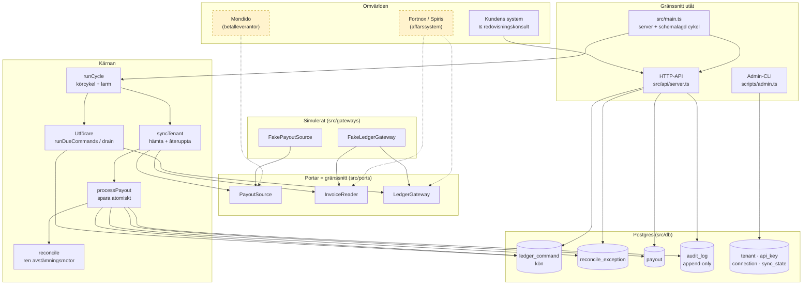
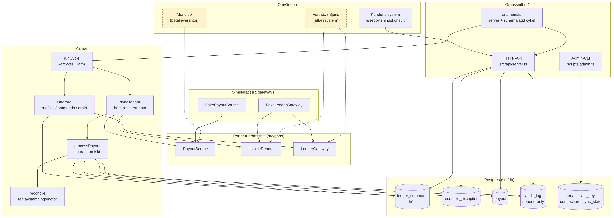
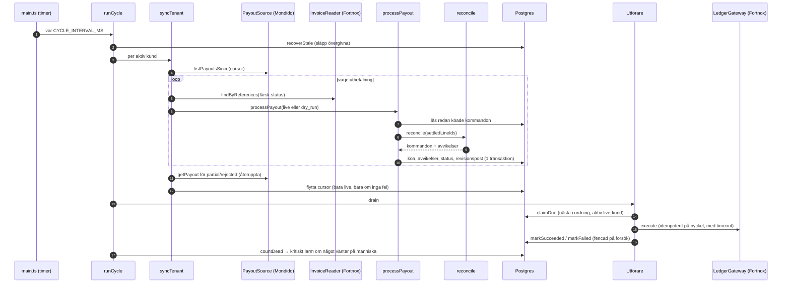
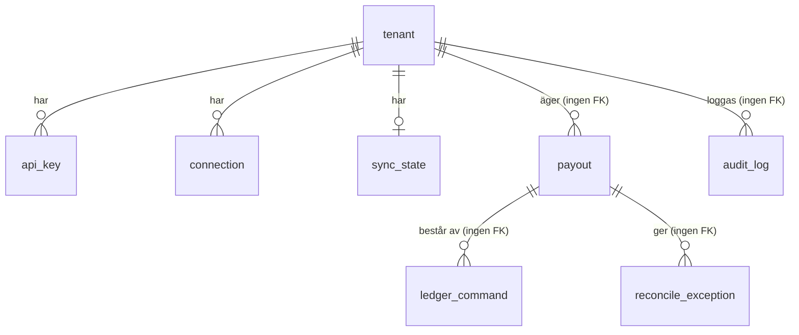

# Funktionskarta

Det här är kartan över **allt som finns** i repot: vilka funktioner systemet har, var i koden varje del bor, vad som testar den och vad som fortfarande är simulerat eller saknas. Använd den när du undrar "finns det redan något som gör X?" eller "var ändrar jag Y?".

Kartan hålls aktuell av ett test (`test/docs.test.ts`): bygget faller om en kodfil, exporterad funktion, API-rutt, avvikelsekod, tabell, migration, npm-skript, adminkommando, miljövariabel eller testfil saknas här. Se [INDEX.md](INDEX.md) för dokumentationsregeln.

**Statusmärken:** ✅ klar och testad · 🧪 klar men bara mot simulerade system · 🔲 saknas (se [NEXT_STEPS.md](NEXT_STEPS.md)).

## 1. Systemkarta

Streckade rutor är externa system som **inte är anslutna ännu**. En färdigrenderad bild av samma karta finns i [karta-system.png](karta-system.png) (ögonblicksbild, diagrammet ovan är den som gäller).

 Allt i "Kärnan" och "Postgres" är byggt och testat.

## 2. Funktionskatalog: vad systemet kan göra

### Avstämning (kärnlogik)

| Funktion | Vad den gör | Kod | Test | Status |
| --- | --- | --- | --- | --- |
| Matcha betalning mot faktura | Exakt referens och exakt belopp. Allt annat blir avvikelse, ingen gissning | `src/engine/reconcile.ts` | `test/reconcile.test.ts`, `test/scenarios/` | ✅ |
| Återbetalning och delkreditering | Hel- eller delkredit med moms/netto fördelat på kvarvarande belopp, utan avrundningsdrift | `reconcile`, `allocate` i `src/domain/money.ts` | `test/engine-review.test.ts`, `test/money.test.ts` | ✅ |
| Avgifter | Avgift per betalning eller som fristående rad (netto + moms) bokförs i verifikatet | `reconcile` | `test/reconcile.test.ts` | ✅ |
| Balanserat verifikat | Ett verifikat per utbetalning (bank, avgifter, ingående moms, clearing). Skapas först när alla rader är lösta | `reconcile` | `test/scenarios/properties.test.ts` | ✅ |
| Summakontroll | Raderna måste summera exakt till utbetalt belopp, annars avvisas hela utbetalningen | `reconcile` | `test/reconcile.test.ts` | ✅ |
| Validering av indata | Ogiltiga belopp, dubbla id, tom utbetalning, ogiltiga fakturor, säkra heltalssummor | `reconcile` | `test/engine-review.test.ts` | ✅ |
| Deterministiska idempotensnycklar | Samma indata ger samma kommandon och nycklar. Kolon i id kodas | `reconcile` | `test/scenarios/properties.test.ts` | ✅ |
| Omkörning utan falska avvikelser | `settledLineIds`: rader som redan köats matchas inte om | `reconcile`, `processPayout` | `test/reconcile.test.ts`, `test/e2e.test.ts` | ✅ |

### Flöde och drift

| Funktion | Vad den gör | Kod | Test | Status |
| --- | --- | --- | --- | --- |
| Spara en utbetalning atomiskt | Kommandon, avvikelser, status och revisionspost i en transaktion | `processPayout` i `src/service/processPayout.ts` | `test/e2e.test.ts` | ✅ |
| Dry-run | Beräkna förslag utan att spara eller logga något. Nya kunder startar här | `processPayout` (`mode: 'dry_run'`) | `test/e2e.test.ts`, `test/sync.test.ts` | ✅ |
| Konfliktdetektering | Upptäcker att en redan köad rad ändrats hos leverantören | `withConflicts` i `processPayout.ts` | `test/e2e.test.ts` | ✅ |
| Auto-stäng avvikelser | Avvikelser som inte längre uppstår stängs vid omkörning | `processPayout` | `test/e2e.test.ts` | ✅ |
| Hämta nya utbetalningar | Hämtar från leverantör efter cursor, avstämmer varje, felisolerat per utbetalning | `syncTenant` i `src/service/syncTenant.ts` | `test/sync.test.ts` | 🧪 |
| Återuppta delvis/avvisade | Hämtar om `partial` och `rejected` varje cykel (en saknad faktura kan ha dykt upp) | `syncTenant` | `test/sync.test.ts`, `test/hardening.test.ts` | 🧪 |
| Kö med ordning per utbetalning | Kommando N släpps först när N-1 lyckats. Samtidighetssäker (`skip locked`, advisory lock) | `src/db/repositories.ts` | `test/db/`, `test/pg/` | ✅ |
| Utförare med omförsök | Backoff, Retry-After (golv/tak), timeout per anrop, dött kommando efter max försök | `runDueCommands`, `drain` i `src/executor/executor.ts` | `test/e2e.test.ts`, `test/hardening.test.ts` | ✅ |
| Återhämtning efter krasch | Släpper kommandon som fastnat; försenade arbetare fencas på försöksnummer | `recoverStale`, `releaseStale` | `test/e2e.test.ts`, `test/db/` | ✅ |
| Körcykel och larm | Synka alla kunder, kör kön, skapa larm (kritiskt så länge något är dött) | `runCycle` i `src/app/cycle.ts` | `test/cycle.test.ts` | ✅ (larm skickas ej vidare) |
| Dött kommando → utbetalning `partial` | `onDead` sätter status och loggar | `createApp` i `src/app/compose.ts` | `test/hardening.test.ts` | ✅ |
| Avstängd kund får inget utfört | `claimDue` hoppar över avstängda och dry_run-kunder | `claimDue` | `test/hardening.test.ts` | ✅ |

### Gränssnitt för människor

| Funktion | Vad den gör | Kod | Test | Status |
| --- | --- | --- | --- | --- |
| Läsa utbetalningar och avvikelser | Tenant-isolerat HTTP-API | `buildServer` i `src/api/server.ts` | `test/api/server.test.ts`, `test/app.test.ts` | ✅ |
| Stänga avvikelse | `POST /v1/exceptions/:id/resolve`, revisionsloggas atomiskt | `buildServer` | `test/api/`, `test/hardening.test.ts` | ✅ |
| Köa om dött kommando | `POST /v1/commands/:id/retry`, revisionsloggas atomiskt | `buildServer`, `requeue` | `test/app.test.ts` | ✅ |
| Administrera kunder | Skapa kund, kontoplan, läge, nycklar, kopplingar via CLI | `scripts/admin.ts` | `scripts/smoke-steps.sh` | ✅ |
| Demo | Berättande genomkörning med simulerade system | `scripts/demo.ts` | körs manuellt (`npm run demo`) | ✅ |
| Rökprov | Temporär Postgres, admin, server, API, nedstängning | `scripts/smoke.sh` | körs manuellt (`npm run smoke`) | ✅ |

### Säkerhet

| Funktion | Vad den gör | Kod | Test | Status |
| --- | --- | --- | --- | --- |
| API-nycklar | Genereras en gång, lagras som HMAC, tidskonstant jämförelse, återkallning, utgång | `src/security/apiKeys.ts`, `src/db/tenants.ts` | `test/security/security.test.ts` | ✅ |
| Kryptering av åtkomsttoken | AES-256-GCM, nyckel-id i blobben, bundet till kund/koppling/fält (AAD), nyckelrotation | `src/security/crypto.ts`, `src/db/connections.ts` | `test/security/security.test.ts` | ✅ (ingen KMS) |
| Tenant-isolering | Alla frågor filtreras på kund; IDOR ger 404 | alla repositorier, `server.ts` | `test/api/server.test.ts`, `test/db/` | ✅ |
| Revisionslogg | Append-only (trigger mot update/delete/truncate), inga belopp eller referenser | `audit_log`, `createAuditLog` | `test/db/repositories.test.ts` | ✅ |
| Inga hemligheter i loggar/fel | Fasta felmeddelanden, tom logger i API, admin skriver aldrig ut indata | `server.ts`, `crypto.ts`, `admin.ts` | `scripts/smoke-steps.sh`, `test/security/` | ✅ |

### Mot omvärlden

| Funktion | Kod | Status |
| --- | --- | --- |
| Hämta utbetalningar från Mondido (`PayoutSource`) | gränssnitt i `src/ports/sources.ts`; simulerad i `src/gateways/fakeSource.ts` | 🔲 adapter saknas |
| Läsa fakturor i Fortnox (`InvoiceReader`) | gränssnitt i `src/ports/sources.ts`; simulerad i `src/gateways/fake.ts` | 🔲 adapter saknas |
| Bokföra i Fortnox (`LedgerGateway`) | gränssnitt i `src/ports/index.ts`; simulerad i `src/gateways/fake.ts` | 🔲 adapter saknas |
| Spiris, fler betalleverantörer | samma gränssnitt | 🔲 |
| Skicka larm (e-post, pager) | `Alert` skapas i `runCycle` | 🔲 |
| Produkt-, lager-, prissynk, order- och fakturaskapande | – | 🔲 ej påbörjat |

## 3. Kodkarta: fil för fil

Läs den som en innehållsförteckning. Interna hjälpfunktioner (ej exporterade) står i kursiv.

### `src/domain/`: typer och pengar (ingen I/O)

| Fil | Ansvar | Funktioner och typer |
| --- | --- | --- |
| `src/domain/money.ts` | Belopp som heltal i minsta enhet, aldrig flyttal | `assertMinor` kontrollerar säkert heltal · `checkedAdd` addition som kastar vid osäkert resultat · `allocate` fördelar exakt (största återstoden) · typ `Minor` |
| `src/domain/types.ts` | Normaliserat format som adaptrar översätter till | `Payout`, `PayoutLine` (payment/refund/fee), `Invoice`, `AccountMapping`, `LedgerCommand` (3 sorter), `ExceptionCode`, `ReconcileInput`, `ReconcileResult` m.fl. |

### `src/engine/`: avstämningsmotorn

| Fil | Ansvar | Funktioner |
| --- | --- | --- |
| `src/engine/reconcile.ts` | Ren funktion: indata in, kommandon + avvikelser ut | `reconcile` · *validatePayout, validateInvoiceIds, invoiceProblem, resolveInvoice, splitCreditVat, buildVoucher* |

### `src/ports/`: gränssnitt (kontrakt mot omvärlden)

| Fil | Ansvar | Innehåll |
| --- | --- | --- |
| `src/ports/index.ts` | Skriv- och lagringsportar | `CommandRepository` (enqueue, claimDue, markSucceeded, markFailed, releaseStale, listByPayout, countDead, requeue) · `ExceptionRepository` (add, list, get, resolve) · `PayoutRepository` (record, get, list) · `AuditLog` (append, list) · `UnitOfWork` (run) · `LedgerGateway` (execute, **måste vara idempotent på nyckeln**) · `LedgerError` · `Clock` |
| `src/ports/sources.ts` | Läsportar och konfiguration | `PayoutSource` (listPayoutsSince, getPayout) · `InvoiceReader` (findByReferences) · `TenantConfigProvider` · `SyncStateStore` · `TenantConfig` |

### `src/service/`: användningsfall

| Fil | Ansvar | Funktioner |
| --- | --- | --- |
| `src/service/processPayout.ts` | Avstäm en utbetalning och spara atomiskt | `processPayout` · *withConflicts, canonical, summarize* |
| `src/service/syncTenant.ts` | Hämta nya + återuppta delvis/avvisade för en kund | `syncTenant` · *count* |

### `src/executor/`: kön till bokföring

| Fil | Ansvar | Funktioner |
| --- | --- | --- |
| `src/executor/executor.ts` | Utför köade kommandon mot gatewayen | `runDueCommands` en omgång · `drain` tills tomt · `recoverStale` släpp övergivna · `backoffDelayMs` · konstant `DEFAULT_STALE_AFTER_MS` · *retryDelay, withTimeout, describeError* |

### `src/db/`: Postgres

| Fil | Ansvar | Funktioner |
| --- | --- | --- |
| `src/db/db.ts` | Minimalt `Db`-gränssnitt (query, exec, transaction) och PGlite-implementation för test | `createPgliteDb` |
| `src/db/pg.ts` | Riktig Postgres via `pg`-pool; bigint tolkas säkert | `createPgDb`, `parseInt8` |
| `src/db/migrations.ts` | Schemaversioner 001 till 004, körs en gång vardera | `migrate`, listan `migrations` |
| `src/db/repositories.ts` | Kö, avvikelser, utbetalningar, revisionslogg, arbetsenhet | `createCommandRepository`, `createExceptionRepository`, `createPayoutRepository`, `createAuditLog`, `createRepositories`, `createUnitOfWork` |
| `src/db/tenants.ts` | Kunder och API-nycklar | `createTenantRepository` (create, get, setStatus, setMode) · `createApiKeyRepository` (issue, revoke, list, findById, touchLastUsed) |
| `src/db/connections.ts` | Krypterade kopplingar till leverantörer | `createConnectionRepository` (upsert, list, getInfo, setStatus, getCredentialsForExecution, reencryptAll, delete) |
| `src/db/syncState.ts` | Cursor, kontoplan och kundkonfiguration för synk | `createSyncStateStore`, `setTenantAccounts`, `createTenantConfigProvider`, `listSyncableTenants`, `accountMappingSchema` |

### `src/security/`: nycklar och kryptering

| Fil | Ansvar | Funktioner |
| --- | --- | --- |
| `src/security/apiKeys.ts` | API-nycklar: generera, hasha, verifiera, autentisera | `generateApiKey`, `hashApiKey`, `verifyApiKey`, `parseApiKeyId`, `createAuthenticator`, konstant `API_KEY_PREFIX` |
| `src/security/crypto.ts` | AES-256-GCM med AAD och nyckelrotation | `encryptSecret`, `decryptSecret`, `parseBlob`, `blobKeyId`, `StaticKeyProvider`, `CryptoError`, gränssnitt `KeyProvider` |

### `src/api/`: HTTP

| Fil | Ansvar | Funktioner |
| --- | --- | --- |
| `src/api/server.ts` | Fastify-server med auth, validering (zod), enhetliga fel | `buildServer` · *atomically, presentException, presentPayout, presentCommand, parse* |

### `src/app/` och `src/main.ts`: sammansättning och start

| Fil | Ansvar | Funktioner |
| --- | --- | --- |
| `src/app/compose.ts` | Kopplar ihop databas, säkerhet, API och körcykel | `createApp` (inkl. `onDead`) |
| `src/app/cycle.ts` | En körcykel: återhämta, synka alla kunder, kör kön, skapa larm | `runCycle`, `silentLogger` |
| `src/app/config.ts` | Läser och validerar miljövariabler utan att läcka värden | `parseEnv` |
| `src/app/notConfigured.ts` | Platshållaradaptrar som misslyckas tydligt | `notConfiguredAdapters` |
| `src/main.ts` | Startpunkt: migrera, starta server, schemalägg cykel, graciös nedstängning | (ingen export) |

### `src/gateways/` och `src/testing/`: simulerat

| Fil | Ansvar | Innehåll |
| --- | --- | --- |
| `src/gateways/fake.ts` | Simulerat affärssystem, idempotent på nyckel | `FakeLedgerGateway` (failNext, addInvoice, invoice, executed, vouchers) |
| `src/gateways/fakeSource.ts` | Simulerad leverantör, konfiguration och synkstatus | `FakePayoutSource`, `MemoryTenantConfig`, `MemorySyncState` |
| `src/testing/memory.ts` | Minnesversioner av repositorierna (för API-tester) | `createMemoryStore`, `createMemoryCommandRepository`, `createMemoryExceptionRepository`, `createMemoryPayoutRepository`. Saknar ordning per utbetalning, använd PGlite när det spelar roll |

### `scripts/` och CI

| Fil | Ansvar |
| --- | --- |
| `scripts/admin.ts` | Adminverktyg (kommandon i avsnitt 6) |
| `scripts/demo.ts` | Berättande demo med simulerade system |
| `scripts/pg-test.sh` | Startar temporär riktig Postgres och kör `test/pg` (eller `PG_RUN_CMD`) |
| `scripts/smoke.sh` | Startar `pg-test.sh` med rökprovet |
| `scripts/smoke-steps.sh` | Stegen i rökprovet: admin, server, API, nedstängning, hemlighetskontroll |
| `.github/workflows/ci.yml` | CI: `npm run check`, samt Postgres-jobb mot `test/pg` |

## 4. En utbetalnings väg genom systemet

## 5. Datamodell

| Tabell | Migration | Innehåll | Repository |
| --- | --- | --- | --- |
| `ledger_command` | 001, 004 | Kön. `seq` ordnar kommandon per utbetalning. Nyckeln är unik per kund | `createCommandRepository` |
| `reconcile_exception` | 001 | Avvikelsekön. Öppen avvikelse unik per (kund, utbetalning, kod, rad) | `createExceptionRepository` |
| `payout` | 001 | Senaste avstämningsstatus per utbetalning (rejected/partial/complete) | `createPayoutRepository` |
| `audit_log` | 001, 004 | Append-only revisionslogg | `createAuditLog` |
| `tenant` | 002, 003 | Kund: status (active/suspended), läge (dry_run/live), kontoplan (jsonb) | `createTenantRepository`, `setTenantAccounts` |
| `api_key` | 002 | HMAC-hash, utgång, återkallning, senast använd | `createApiKeyRepository` |
| `connection` | 002 | Krypterade uppgifter per (kund, leverantör), status | `createConnectionRepository` |
| `sync_state` | 003 | Cursor per kund | `createSyncStateStore` |
| `schema_migrations` | (skapas av `migrate`) | Vilka migrationer som körts | `migrate` |

**Migrationer:** `001_init` (kö, avvikelser, utbetalning, revisionslogg) · `002_tenants_connections` (kunder, nycklar, kopplingar) · `003_sync_state_and_accounts` (cursor, kontoplan) · `004_command_key_per_tenant_and_audit_truncate` (nyckel per kund, skydd mot truncate).

## 6. Gränssnitt utåt

### HTTP-API (alla `/v1`-rutter kräver headern `x-api-key`; detaljer i [API.md](API.md))

| Rutt | Gör |
| --- | --- |
| `GET /health` | Öppen livstecken |
| `GET /v1/exceptions` | Lista avvikelser (`status`, `payoutId`) |
| `GET /v1/exceptions/:id` | En avvikelse |
| `POST /v1/exceptions/:id/resolve` | Stäng avvikelse (resolved/dismissed + anteckning). Loggas |
| `POST /v1/commands/:id/retry` | Köa om dött kommando. Loggas |
| `GET /v1/payouts` | Lista utbetalningar (`status`) |
| `GET /v1/payouts/:id` | En utbetalning med dess kommandon |

### Adminkommandon (`npm run admin -- <kommando>`)

`create-tenant` · `set-accounts` · `set-mode` · `suspend` · `activate` · `issue-key` · `revoke-key` · `set-connection` · `list-tenants`. Varje åtgärd skriver en revisionspost med `actor: admin-cli`.

### npm-skript

| Skript | Gör |
| --- | --- |
| `npm run check` | Typkontroll + alla tester (ingen databas behövs) |
| `npm run typecheck` | Bara typkontroll |
| `npm test` | Bara tester |
| `npm run test:pg` | Tester mot temporär riktig Postgres |
| `npm run smoke` | Rökprov av hela tjänsten |
| `npm run demo` | Berättande demo |
| `npm run admin` | Adminverktyget |
| `npm start` | Starta tjänsten |

### Miljövariabler (läses av `parseEnv`)

`DATABASE_URL` · `API_KEY_PEPPER` (32 byte) · `MASTER_KEYS` (`id:nyckel,...`, första är aktuell) · `PORT` (3000) · `HOST` (0.0.0.0) · `CYCLE_INTERVAL_MS` (60000, 0 = bara API). Testmiljö: `PG_TEST_URL` (riktig Postgres för `test/pg`), `PG_BIN`, `PG_RUN_USER`, `PG_TEST_PORT`, `PG_RUN_CMD` (för `scripts/pg-test.sh`).

### Revisionsposter (`audit_log.action`)

`payout.processed` · `command.dead` · `exception.resolved` · `command.requeued` · `tenant.created` · `tenant.accounts_set` · `tenant.mode_set` · `tenant.active` · `tenant.suspended` · `api_key.issued` · `api_key.revoked` · `connection.set`. Innehåller aldrig belopp, referenser eller fria anteckningar.

## 7. Koder och tillstånd

### Avvikelsekoder (`ExceptionCode`): åtgärder i [RUNBOOK.md](RUNBOOK.md)

| Kod | Betyder | Nivå |
| --- | --- | --- |
| `PAYOUT_SUM_MISMATCH` | Raderna summerar inte till utbetalt belopp | hela utbetalningen avvisas |
| `DUPLICATE_LINE_ID` | Samma rad-id två gånger | avvisas |
| `INVALID_AMOUNT` | Negativt/decimal/nollbelopp eller för stora summor | avvisas eller rad |
| `CURRENCY_MISMATCH` | Rad och utbetalning, eller rad och faktura, har olika valuta | avvisas eller rad |
| `INVALID_PAYOUT` | Tomt id, ogiltigt datum, rad utan referens, okänd radtyp | avvisas |
| `EMPTY_PAYOUT` | Utbetalning utan rader | avvisas |
| `DUPLICATE_INVOICE_ID` | Samma faktura-id två gånger i indata | avvisas |
| `NO_MATCH` | Ingen faktura med referensen | rad |
| `AMBIGUOUS_MATCH` | Flera fakturor med samma referens | rad |
| `INVOICE_NOT_OPEN` | Fakturan är redan betald/annullerad (eller obetald vid återbetalning) | rad |
| `AMOUNT_MISMATCH` | Beloppet stämmer inte exakt med fakturans obetalda | rad |
| `REFUND_EXCEEDS_INVOICE` | Återbetalning större än kvarvarande krediterbart | rad |
| `INVALID_INVOICE` | Fakturadata hänger inte ihop (t.ex. moms > total) | rad |
| `COMMAND_CONFLICT` | En redan köad rad har ändrats hos leverantören | rad (sätts av `processPayout`) |
| `INTERNAL_IMBALANCE` | Verifikatet balanserar inte (ska aldrig hända) | verifikat uteblir |

### Tillstånd

| Sak | Värden |
| --- | --- |
| Kommando (`CommandStatus`) | `pending` → `in_progress` → `succeeded`; fel: `failed` (nytt försök) eller `dead` (kräver människa, `requeue` tillbaka till `pending`) |
| Kommandosorter (`LedgerCommand.kind`) | `register_invoice_payment`, `credit_invoice`, `post_voucher` |
| Utbetalning (`PayoutStatus`) | `rejected` · `partial` · `complete` (= avstämd och köad, inte nödvändigtvis utförd) |
| Avvikelse (`ExceptionStatus`) | `open` · `resolved` · `dismissed` |
| Kund | status `active`/`suspended`; läge `dry_run`/`live` |
| Koppling | `active` · `disabled` · `needs_reauth` (bara `active` lämnar ut uppgifter) |

Tillståndsdiagram och regler: [ARCHITECTURE.md](ARCHITECTURE.md) avsnitt 4.

## 8. Testkarta

| Testfil | Täcker |
| --- | --- |
| `test/reconcile.test.ts` | Motorns grundbeteenden: lyckad, omkörning, avvisad, delvis, återbetalningar |
| `test/engine-review.test.ts` | Regression för granskningsfynd (dubbla id, ogiltiga fakturor, moms, nycklar, summor) |
| `test/money.test.ts` | `allocate` |
| `test/scenarios/golden.test.ts` | 16 verkliga e-handelsfall |
| `test/scenarios/properties.test.ts` | Egenskapstester med fast-check |
| `test/scenarios/helpers.ts` | Byggare för scenariotesterna |
| `test/db/repositories.test.ts` | Kö, avvikelser, utbetalningar, revisionslogg, arbetsenhet (PGlite) |
| `test/db/syncState.test.ts` | Cursor och kundkonfiguration |
| `test/e2e.test.ts` | Hela kedjan, felhantering i utföraren, ändrade rader |
| `test/sync.test.ts` | `syncTenant`: nya, återuppta, felisolering, dry_run |
| `test/cycle.test.ts` | `runCycle` och larm |
| `test/app.test.ts` | Hela produkten via HTTP-API, mänskliga åtgärder |
| `test/hardening.test.ts` | Fynd från oberoende granskning |
| `test/api/server.test.ts` | API: auth, isolering, validering, inga läckor |
| `test/api/memory.test.ts` | Minnesrepositorierna |
| `test/security/security.test.ts` | Kryptering, API-nycklar, kunder, kopplingar |
| `test/pg/contract.ts` | Delad kontraktssvit för databaslagret |
| `test/pg/pglite.test.ts` | Kontraktet mot PGlite |
| `test/pg/pg.test.ts` | Kontraktet + samtidighet mot riktig Postgres (kräver `PG_TEST_URL`) |
| `test/pg/support.ts` | Schema per test för Postgres-sviten |
| `test/helpers.ts` | Gemensamma testhjälpare (klocka, databas, byggare) |
| `test/docs.test.ts` | Att den här kartan och övrig dokumentation är komplett |

## 9. Hitta rätt

| Jag vill... | Gå till |
| --- | --- |
| Ändra hur en betalning matchas | `src/engine/reconcile.ts` (`resolveInvoice`) |
| Ändra hur moms fördelas vid kreditering | `splitCreditVat` i `reconcile.ts` |
| Ändra vad verifikatet innehåller | `buildVoucher` i `reconcile.ts` |
| Lägga till en avvikelsekod | `ExceptionCode` i `types.ts`, sedan RUNBOOK + den här kartan |
| Lägga till en endpoint | `server.ts`, sedan API.md + den här kartan |
| Lägga till en tabell/kolumn | ny migration sist i `migrations.ts` (ändra aldrig en körd), sedan avsnitt 5 |
| Koppla in Fortnox | implementera `LedgerGateway` + `InvoiceReader`, koppla i `createApp`-anroparen (`main.ts`). Läs först NEXT_STEPS |
| Koppla in Mondido | implementera `PayoutSource` |
| Ändra omförsök/timeout | `ExecutorOptions` i `executor.ts` |
| Förstå varför något togs bort/ändrades | [DECISIONS.md](DECISIONS.md) och [LOGG.md](LOGG.md) |
| Driftproblem | [RUNBOOK.md](RUNBOOK.md) |
